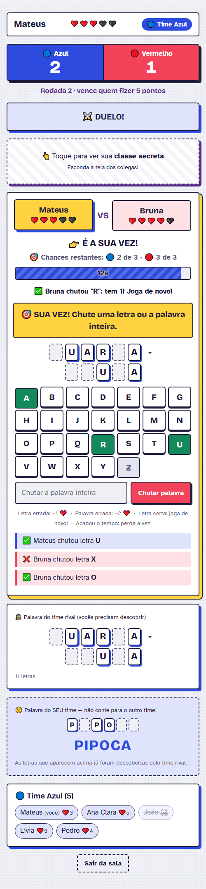
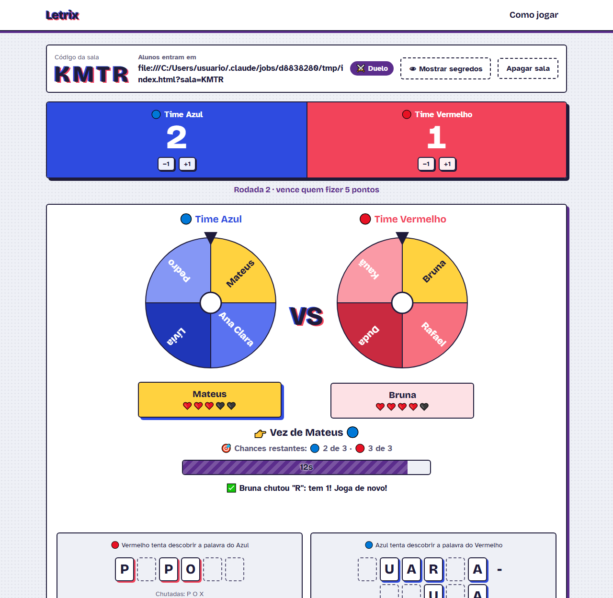
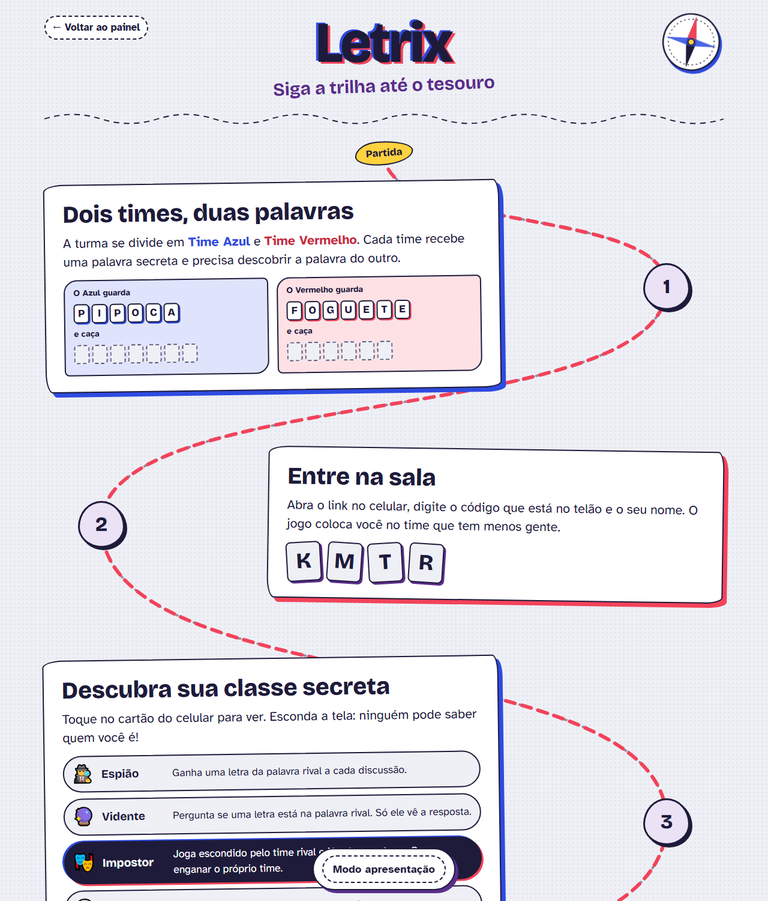

# Letrix

**Letrix é um projeto educativo desenvolvido para dinâmicas em sala de aula.** É um jogo em grupo,
jogado pelo celular, que mistura **forca** com **Cidade Dorme**. A turma se divide em dois times, cada
time guarda uma palavra secreta e precisa descobrir a palavra do outro, enquanto um impostor escondido
tenta atrapalhar.

O professor (o **mediador**) cria a sala, projeta o painel no telão e o jogo anda sozinho:
discussão, roleta, duelo e de novo. Os alunos só precisam do navegador do celular.

<p align="center">
  
</p>

## Para que serve em sala

- **Vocabulário e ortografia:** os alunos montam a palavra letra por letra, como na forca. A lista
  de palavras é do professor, então dá para usar os termos da matéria (ciências, história, inglês,
  programação…).
- **Raciocínio e dedução:** cada letra revelada é uma pista. O time discute quais palavras ainda são
  possíveis antes de chutar.
- **Comunicação e trabalho em equipe:** na discussão o time precisa chegar a um acordo, por maioria,
  sobre quem é o impostor.
- **Argumentação:** o impostor tenta convencer o time da coisa errada; os outros precisam perceber
  o que não faz sentido.
- **Participação de todos:** a roleta sorteia quem duela, dando prioridade a quem jogou menos.

## Como funciona

### Os times e as palavras
Os alunos entram com um código e são divididos em **Time Azul** e **Time Vermelho**. A cada rodada o
jogo sorteia uma palavra para cada time. Cada aluno vê a palavra do próprio time e precisa descobrir
a do time rival.

### As classes secretas
No começo de cada rodada, cada aluno recebe uma classe que só ele vê no celular:

| Classe | A partir de | O que faz |
|---|---|---|
| 🕵️ Espião | 2 alunos no time | Ganha uma letra secreta da palavra rival a cada discussão |
| 🔮 Vidente | 3 alunos no time | Em cada discussão, pergunta se uma letra está na palavra rival (só ele vê a resposta) |
| 🎭 Impostor | 4 alunos no time | Joga escondido pelo time rival e já sabe a palavra que o próprio time procura. Quer enganar o time |
| 🛡️ Guardião | 5 alunos no time | O primeiro erro dele no duelo não tira vida |
| 🙂 Cidadão | — | Sem poder especial, mas com voto |

### O ciclo do jogo
Depois que o mediador clica em **Começar jogo**, as fases se repetem sozinhas:

```
Rodada nova → 💬 Discussão → resultado dos votos → 🎡 Roleta → ⚔️ Duelo → resultado → 💬 Discussão → ...
```

1. **Discussão.** Cada time conversa baixinho sobre qual pode ser a palavra rival e vota em quem
   acha que é o impostor. Se a maioria dos vivos votar na mesma pessoa:
   - era o impostor: **+1 ponto** e ele sai da rodada;
   - era inocente: o inocente sai da rodada.
2. **Roleta.** Sorteia um aluno de cada time para o duelo.
3. **Duelo.** Na sua vez (15 s por padrão), o aluno chuta uma letra ou a palavra inteira:
   - letra certa: aparece para todos e ele **joga de novo**;
   - letra errada: **−1 ❤️**; palavra errada: **−2 ❤️**;
   - tempo esgotado: perde a vez.

   Cada erro ou tempo esgotado gasta uma **chance**. Quando os dois duelistas gastam todas, o duelo
   acaba e volta a discussão.

**Fim da rodada:** alguém descobriu a palavra (+1 ponto e os impostores são revelados) ou um time
inteiro ficou sem vidas (ponto para o outro). Começa uma rodada nova, com palavras, classes e vidas novas.

**Fim do jogo:** vence o primeiro time que chegar aos pontos combinados.

## As telas

| Arquivo | Quem usa | Para quê |
|---|---|---|
| `professor.html` | Mediador | Cria a sala, ajusta o jogo e mostra roletas, duelo e placar no telão. **É o juiz e o motor do jogo: precisa ficar aberta.** |
| `index.html` | Alunos | Entram com o código e o nome e jogam pelo celular |
| `como-jogar.html` | Mediador | Explica as regras em formato de mapa do tesouro, com modo apresentação |

<p align="center">
  
</p>

### Painel do mediador
Antes de começar, o mediador pode ajustar:
- 🏆 pontos para vencer;
- ❤️ vidas por jogador;
- 🎯 chances de cada duelista por duelo;
- ⏱ segundos por jogada e 💬 segundos de discussão;
- 📝 lista de palavras (uma por linha). Se ficar vazia, o jogo usa uma lista própria.

Durante o jogo:
- **⏸ Pausar / ▶ Continuar** congela tudo, inclusive os cronômetros;
- **⏹ Encerrar jogo** termina na hora, e vence quem tiver mais pontos;
- **👁 Mostrar segredos** revela palavras e classes, que ficam borradas para o telão;
- ferramentas de ajuste: dar uma letra de dica, ±1 no placar, devolver vidas, trocar aluno de time,
  remover aluno e embaralhar times.

### Como jogar (para apresentar à turma)
Acessível pelo menu **Como jogar** no topo do painel. As regras aparecem como paradas de uma trilha
até o tesouro. No modo apresentação, cada parada se revela quando o barquinho chega nela. Use
**→**, **Espaço** ou um passador de slides para avançar, **←** para voltar e **T** para ver tudo.

<p align="center">
  
</p>

## Tecnologia

- HTML, CSS e JavaScript puros, sem etapa de build: os arquivos rodam direto no navegador.
- [Supabase](https://supabase.com) (plano gratuito) como banco de dados e para atualizar as telas em
  tempo real.
- Fontes [Bricolage Grotesque](https://fonts.google.com/specimen/Bricolage+Grotesque) e
  [Atkinson Hyperlegible](https://fonts.google.com/specimen/Atkinson+Hyperlegible), esta pensada para
  facilitar a leitura.

## Como colocar para funcionar

### 1. Banco de dados (uma vez só)
1. Crie um projeto em <https://supabase.com>.
2. No **SQL Editor**, cole o conteúdo de [`supabase.sql`](supabase.sql) e clique em **Run**.
   Rodar de novo apaga as salas existentes.
   > Já tinha um banco de uma versão anterior do Letrix? Rode só o
   > [`supabase-atualizacao.sql`](supabase-atualizacao.sql). Ele acrescenta as colunas novas sem apagar nada.
3. Em **Project Settings > API**, copie a **Project URL** e a chave pública (**anon** / **publishable**).
4. Cole as duas em [`js/config.js`](js/config.js).

### 2. Publicar para os alunos
O jogo é só um conjunto de arquivos estáticos. Pelo **GitHub Pages**:
1. No repositório, abra **Settings > Pages**.
2. Em **Source**, escolha **Deploy from a branch**, a branch **main** e a pasta **/ (root)**.
3. Depois de um ou dois minutos o jogo fica em `https://<seu-usuario>.github.io/Letrix/`:
   - alunos: `.../Letrix/` (ou o link com o código que aparece no painel);
   - mediador: `.../Letrix/professor.html`.

Também funciona no Netlify, no Vercel ou em qualquer hospedagem de arquivos.

### 3. Na aula
1. Abra o `professor.html`, clique em **Criar nova sala** e projete a tela.
2. Se quiser, apresente as regras pelo menu **Como jogar**.
3. Os alunos abrem o link no celular e digitam o código e o nome.
4. Ajuste o que quiser e clique em **▶ Começar jogo**.

## Dicas e cuidados

- **Deixe a aba do painel aberta e visível.** Ela confere as jogadas e faz o jogo andar. Com a aba
  muito tempo em segundo plano, o navegador a desacelera e as fases podem atrasar.
- **Supabase gratuito:** o projeto é pausado depois de cerca de uma semana sem uso. Antes da aula,
  abra o painel do Supabase e confira se ele está ativo. Se a sala não for criada, o jogo mostra o motivo.
- **Para testar sozinho**, use uma janela anônima ou outro aparelho para cada jogador. Abas comuns do
  mesmo navegador dividem o mesmo jogador.
- **Depois de alterar o código:** aumente o número `?v=` nos links de CSS e JS dos arquivos `.html`
  (por exemplo, de `?v=2` para `?v=3`). Assim os navegadores baixam os arquivos novos em vez de usar
  os guardados.
- **Sobre segurança:** o jogo não tem login, e a chave em `js/config.js` é a chave pública do Supabase,
  feita para ficar no navegador. Um aluno que saiba usar as ferramentas de desenvolvedor consegue ver
  as palavras e as classes. Para uma dinâmica em sala isso não costuma ser problema, mas não use o
  Letrix para avaliações que valham nota.

## Estrutura do projeto

```
├── index.html              tela do aluno
├── professor.html          painel do mediador
├── como-jogar.html         guia das regras (mapa do tesouro)
├── css/
│   ├── style.css           visual do jogo
│   └── mapa.css            visual do guia
├── js/
│   ├── config.js           URL e chave do Supabase
│   ├── common.js           funções compartilhadas (palavras, sons, tempo real)
│   ├── aluno.js            lógica da tela do aluno
│   ├── professor.js        juiz e motor do ciclo automático
│   ├── roleta.js           roleta desenhada em canvas
│   └── mapa.js             trilha e modo apresentação do guia
├── supabase.sql            cria as tabelas (projeto novo)
├── supabase-atualizacao.sql  atualiza um banco antigo
└── docs/img/               imagens deste README
```
